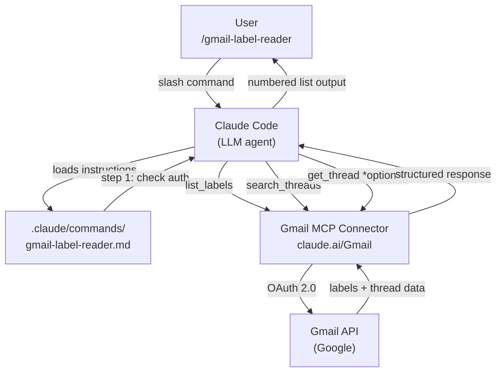
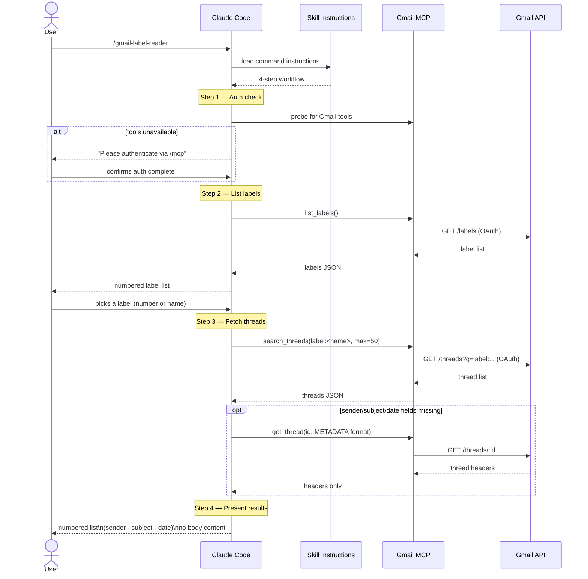

# Gmail Label Reader

A Claude Code skill that authenticates with Gmail, lists all labels, and retrieves email metadata (sender, subject, date) from a chosen label — without reading message bodies.

---

## Quick Start

Type `/gmail-label-reader` in any Claude Code session inside this project.

If Gmail tools aren't available yet, Claude will prompt you to authenticate via `/mcp` → "claude.ai Gmail".

---

## File Tree

```
.
├── .claude/
│   └── commands/
│       └── gmail-label-reader.md      # Slash command — invoked via /gmail-label-reader
│
├── skills/
│   └── gmail-label-reader/
│       ├── SKILL.md                   # Canonical skill definition (source of truth)
│       └── evals/
│           └── evals.json             # Test cases and pass/fail assertions for the skill
│
├── gmail-label-reader-workspace/      # Eval run history (snapshot baselines)
│   ├── iteration-1/
│   │   └── eval-1/
│   │       ├── eval_metadata.json     # Assertions for this iteration's test
│   │       └── with_skill/
│   │           └── outputs/
│   │               └── summary.md    # Captured output from skill-guided run
│   └── iteration-2/
│       └── eval-1/
│           ├── eval_metadata.json     # Refined assertions after skill refactor
│           ├── with_skill/
│           │   └── outputs/
│           │       └── output.md     # Output: skill produces numbered list format
│           └── without_skill/
│               └── outputs/
│                   └── output.md     # Baseline: raw table with label IDs exposed
│
├── .devcontainer/
│   └── devcontainer.json             # Dev container configuration
├── .gitignore
└── README.md
```

### Key distinction: `SKILL.md` vs `.claude/commands/gmail-label-reader.md`

| File | Role |
|---|---|
| `skills/gmail-label-reader/SKILL.md` | Canonical source. Edit this to change skill behaviour. |
| `.claude/commands/gmail-label-reader.md` | Claude Code slash command. Mirrors the skill content so `/gmail-label-reader` triggers it. |

When you update the skill, copy the relevant content into the commands file to keep them in sync.

---

## Architecture



---

## Sequence



---

## Eval Framework

Evals compare **with-skill** runs (Claude following `SKILL.md`) against **without-skill** baseline runs (Claude answering the same prompt unaided).

Each eval defines a prompt and a set of pass/fail assertions:

```
prompt: "Check my Gmail, show me my labels, then list the email titles in Work/Startups"

assertions:
  1. Presents a numbered list of Gmail labels before fetching any emails
  2. Fetches emails from the correct label (Work/Startups)
  3. Each email entry shows sender, subject, and date
  4. No email body content or summaries are included in the output
  5. Results are presented as a clean numbered list
```

Run history is stored in `gmail-label-reader-workspace/` by iteration. Each iteration captures both the `with_skill` and `without_skill` outputs as snapshot baselines.

---

## Privacy

This skill reads **headers only** (sender, subject, date). Message bodies are never fetched or processed. Authentication is handled by the claude.ai Gmail MCP connector via OAuth 2.0 — no credentials are stored in this repository.
