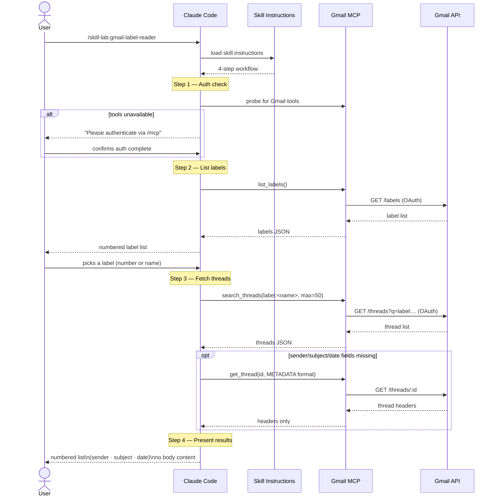

# Claude Skills Monorepo

A collection of custom Claude Code skills — each self-contained with its definition and eval history.

---

## Skills

| Skill | Slash Command | Description |
|---|---|---|
| [gmail-label-reader](skills/gmail-label-reader/) | `/skill-lab:gmail-label-reader` | List Gmail labels and browse email titles by label |
| [new-project](skills/new-project/) | `/skill-lab:new-project` | Turn an empty folder into a project with Dom's standards, up to a gated first commit |

---

## Install

The repo is a Claude Code plugin marketplace (`skill-lab`) that lists one plugin (`skill-lab`) containing every skill under `skills/`.

From a shell:

```sh
claude plugin marketplace add dominicfarr/claude-skill-lab
claude plugin install skill-lab@skill-lab
```

Or inside a Claude Code session:

```
/plugin marketplace add dominicfarr/claude-skill-lab
/plugin install skill-lab@skill-lab
```

On Claude Code 2.1.275 or later you can do it in one step (or from a shell: `claude plugin install skill-lab --marketplace dominicfarr/claude-skill-lab`):

```
/plugin install skill-lab --marketplace dominicfarr/claude-skill-lab
```

Run `/reload-plugins` (or start a new session) and the skills are available. Claude picks them up from what you ask, or you can invoke one directly, e.g. `/skill-lab:gmail-label-reader`. If a skill requires external authentication (e.g. Gmail), Claude will prompt you on first use.

To pick up new skills later: `claude plugin marketplace update skill-lab`, then `claude plugin update skill-lab@skill-lab`.

### Check the install

`scripts/test-plugin-install.sh` validates the manifests, adds the marketplace in a throwaway config dir, installs the plugin, and confirms every skill in `skills/` loaded. Pass `dominicfarr/claude-skill-lab` to test the published repo instead of your working copy.

---

## Adding a New Skill

```
skills/
└── your-skill-name/
    ├── SKILL.md                  # Skill definition (source of truth)
    └── evals/
        ├── evals.json            # Test cases and assertions
        └── runs/                 # Captured eval outputs (auto-generated)
```

1. Write `skills/your-skill-name/SKILL.md`
2. Add test cases to `skills/your-skill-name/evals/evals.json`
3. Add a row to the Skills table above
4. Run `scripts/test-plugin-install.sh` to confirm the plugin loads it

New skill directories are picked up by the plugin automatically; no manifest change is needed.

---

## File Tree

```
.
├── skills/
│   ├── new-project/
│   │   ├── SKILL.md
│   │   ├── scripts/                       # check-safe.sh, copy-standards.sh
│   │   └── evals/                         # evals.json, run-evals.sh, check.sh, gh-guard/, runs/
│   └── gmail-label-reader/
│       ├── SKILL.md                       # Canonical skill definition
│       └── evals/
│           ├── evals.json                 # Test prompts and pass/fail assertions
│           └── runs/                      # Eval run history (snapshot baselines)
│               ├── iteration-1/
│               │   └── eval-1/
│               │       ├── eval_metadata.json
│               │       └── with_skill/outputs/summary.md
│               └── iteration-2/
│                   └── eval-1/
│                       ├── eval_metadata.json
│                       ├── with_skill/outputs/output.md
│                       └── without_skill/outputs/output.md
│
├── .claude-plugin/
│   ├── plugin.json                        # Plugin manifest (skill-lab)
│   └── marketplace.json                   # Marketplace manifest listing the plugin
│
├── scripts/
│   └── test-plugin-install.sh             # Install check
│
├── .devcontainer/
│   └── devcontainer.json                  # Dev container configuration
├── .gitignore
└── README.md
```

---

## Eval Framework

Each skill has a structured eval that compares **with-skill** runs (Claude following `SKILL.md`) against **without-skill** baseline runs (Claude answering the same prompt unaided).

```
evals/
├── evals.json          # Test prompts + assertions (authored)
└── runs/               # Captured outputs per iteration (generated)
    ├── iteration-1/
    └── iteration-2/
```

Each eval defines a prompt and a set of pass/fail assertions. Run outputs are captured as markdown snapshots under `runs/` and committed as baselines for regression comparison.

---

## gmail-label-reader

### Architecture

### Sequence



### Privacy

Reads **headers only** (sender, subject, date). Message bodies are never fetched or processed. Authentication is via OAuth 2.0 through the claude.ai Gmail MCP connector — no credentials are stored in this repository.

---

## new-project

Run `/skill-lab:new-project [repo-name]` in an empty folder, or one holding only an idea note. It refuses a folder with git history (or inside another repo) and a repo name `dominicfarr` already has, then: `git init` on `main`, copies the standard files and base gates from `dominicfarr/dev-standards`, sets up the Matt Pocock skills (GitHub tracker, default triage labels, single-context), writes `CLAUDE.md` with the "Read first" line and a README with *Development setup*, installs the `pre-commit` and `commit-msg` hooks, and makes a first commit that passes them. Only then does it create the public `dominicfarr/<repo-name>` repo, push `main`, create the missing triage labels and watch the first CI run. Pass `--local-only` to stop after the first commit and keep the repo local.

Needs `gh` (logged in), `uv`, pre-commit and the `mattpocock-skills` plugin.

### What it copies

From the standards repo's default branch, through `gh api`, all read at one commit: `.gitignore`, `CONTRIBUTING.md`, `docs/DEVELOPMENT.md`, `.pre-commit-config.yaml`, `commitlint.config.mjs`, `.github/workflows/ci.yml` and `.github/dependabot.yml`. Hook fragments and Sonar templates come later, through the stack and Sonar tickets. The list lives in `skills/new-project/scripts/copy-standards.sh`.

Each copy's first line is a **source header** naming that commit, in the file's own comment syntax: `# from dominicfarr/dev-standards@<sha>` (YAML, `.gitignore`), `<!-- … -->` (Markdown), `// …` (`.mjs`). Every file in the set can carry a comment on line 1. The script refuses a file type with no comment syntax (such as JSON) instead of copying it without a header, so adding one means choosing its fallback first.

### Evals

```sh
skills/new-project/evals/run-evals.sh <iteration>               # every eval, with and without the skill
skills/new-project/evals/run-evals.sh <iteration> with_skill 1  # one eval, one variant
```

Each eval runs `claude -p` in a fresh scratch folder under `$TMPDIR`, with a scoped tool allowlist, and `check.sh` grades the folder from outside (and, for the refuse-history eval, checks the reply quotes `check-safe.sh`'s refusal). No eval can create a GitHub repo: GitHub writes and `git push` are denied, a `gh` guard first on PATH refuses them too, the skill runs with `--local-only`, and `check.sh` confirms `dominicfarr/<folder>` doesn't exist afterwards. Results land in `evals/runs/iteration-<n>/`.
