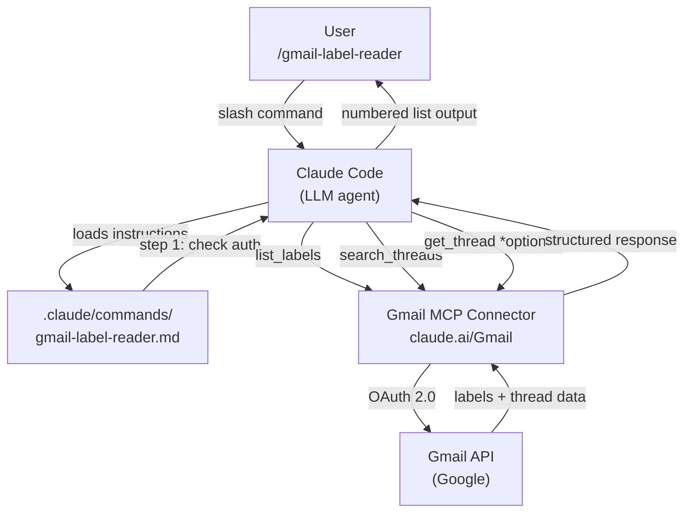
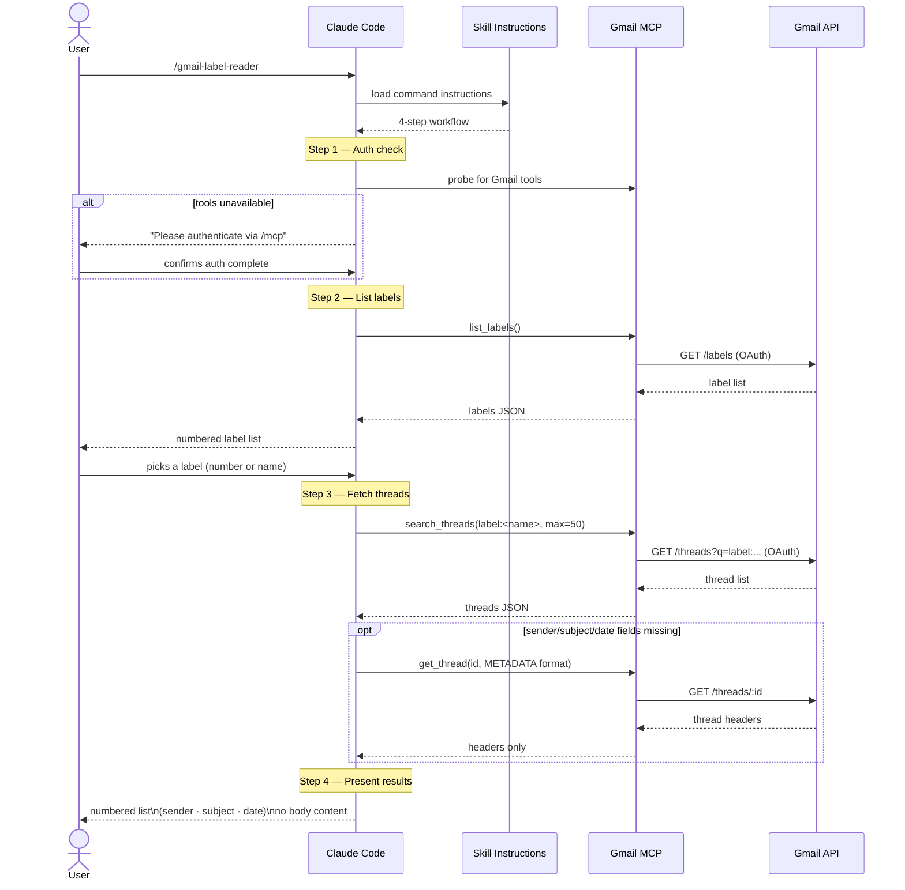

# Claude Skills Monorepo

A collection of custom Claude Code skills — each self-contained with its definition, slash command, and eval history.

---

## Skills

| Skill | Slash Command | Description |
|---|---|---|
| [gmail-label-reader](skills/gmail-label-reader/) | `/gmail-label-reader` | List Gmail labels and browse email titles by label |

---

## Quick Start

Type the slash command for any skill directly in Claude Code. If a skill requires external authentication (e.g. Gmail), Claude will prompt you on first use.

---

## Adding a New Skill

```
skills/
└── your-skill-name/
    ├── SKILL.md                  # Skill definition (source of truth)
    └── evals/
        ├── evals.json            # Test cases and assertions
        └── runs/                 # Captured eval outputs (auto-generated)

.claude/commands/
└── your-skill-name.md            # Copy of skill instructions — enables /your-skill-name
```

1. Write `skills/your-skill-name/SKILL.md`
2. Copy the instructions into `.claude/commands/your-skill-name.md`
3. Add test cases to `skills/your-skill-name/evals/evals.json`
4. Add a row to the Skills table above

---

## File Tree

```
.
├── .claude/
│   └── commands/                          # Slash commands (one per skill)
│       └── gmail-label-reader.md
│
├── skills/
│   └── gmail-label-reader/
│       ├── SKILL.md                       # Canonical skill definition
│       └── evals/
│           ├── evals.json                 # Test prompts and pass/fail assertions
│           └── runs/                      # Eval run history (snapshot baselines)
│               ├── iteration-1/
│               │   └── eval-1/
│               │       ├── eval_metadata.json
│               │       └── with_skill/outputs/summary.md
│               └── iteration-2/
│                   └── eval-1/
│                       ├── eval_metadata.json
│                       ├── with_skill/outputs/output.md
│                       └── without_skill/outputs/output.md
│
├── .devcontainer/
│   └── devcontainer.json                  # Dev container configuration
├── .gitignore
└── README.md
```

### `SKILL.md` vs `.claude/commands/<name>.md`

| File | Role |
|---|---|
| `skills/<name>/SKILL.md` | Canonical source. Edit here to change behaviour. |
| `.claude/commands/<name>.md` | Mirrors the skill so the slash command works. Keep in sync when SKILL.md changes. |

---

## Eval Framework

Each skill has a structured eval that compares **with-skill** runs (Claude following `SKILL.md`) against **without-skill** baseline runs (Claude answering the same prompt unaided).

```
evals/
├── evals.json          # Test prompts + assertions (authored)
└── runs/               # Captured outputs per iteration (generated)
    ├── iteration-1/
    └── iteration-2/
```

Each eval defines a prompt and a set of pass/fail assertions. Run outputs are captured as markdown snapshots under `runs/` and committed as baselines for regression comparison.

---

## gmail-label-reader

### Architecture



### Sequence



### Privacy

Reads **headers only** (sender, subject, date). Message bodies are never fetched or processed. Authentication is via OAuth 2.0 through the claude.ai Gmail MCP connector — no credentials are stored in this repository.
